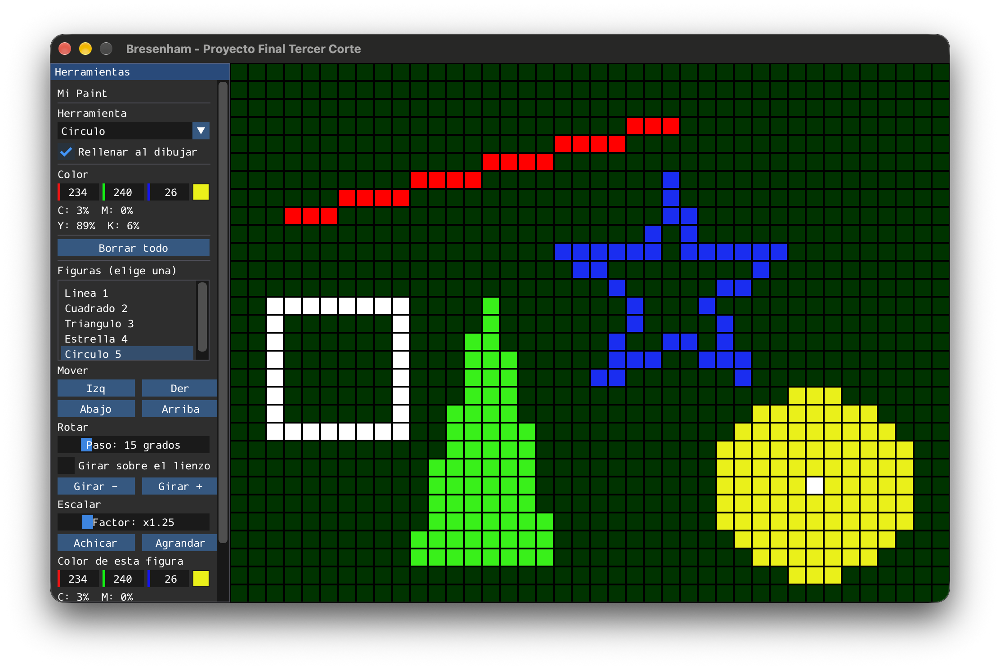
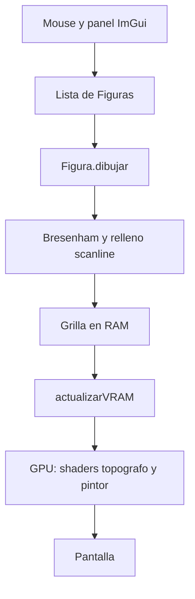

# Mi Paint con Bresenham

Proyecto Final (Tercer Corte) de Computación Gráfica.

**Autor:** Josthin Santiago Buitrago Tovar · 

**Curso:** INTRODUCCION A COMPUTACION GRAFICA GRUPO MUL B - Universidad Militar Nueva Granada

Un programa de dibujo en C++ y OpenGL donde el lienzo es una grilla de 40×30 "píxeles gigantes". Todas las figuras se trazan con algoritmos hechos a mano (Bresenham, relleno por línea de barrido y transformaciones 2D), y la interfaz está hecha con Dear ImGui.



## Qué puede hacer

- **Herramientas de dibujo** (clic y arrastre, con vista previa): línea, círculo, rectángulo, lápiz libre, triángulo, cuadrado, polígono regular (3 a 12 lados) y estrella (3 a 12 puntas).
- **Relleno** de círculos y polígonos con el algoritmo de línea de barrido (*scanline*).
- **Color:** selector RGB con su equivalente CMYK.
- **Transformaciones 2D** sobre cualquier figura seleccionada: trasladar, rotar y escalar, alrededor de su propio centro o del centro del lienzo.
- **Edición:** lista de figuras, cambiar el color de una figura, borrar una figura o todas.

## Cómo ejecutarlo (macOS)

Requisitos: macOS con [Homebrew](https://brew.sh), compilador de C++17 y CMake.

```bash
brew install glfw cmake
git clone https://github.com/JosthinBuitrago/MiProyectoOpenGL
cd MiProyectoOpenGL
mkdir -p build && cd build
cmake ..
make
./App
```

> El programa se ejecuta **desde la carpeta `build`**, porque busca los shaders en `../shaders/`.

Tecnologías: C++17, OpenGL 3.3 Core, GLFW, GLAD, Dear ImGui 1.93 (incluida en `libs/imgui`) y CMake.

## Estructura del proyecto

```
├── CMakeLists.txt        Cómo se compila todo
├── include/              Cabeceras de GLAD y KHR
├── libs/imgui/           Dear ImGui (código fuente)
├── shaders/
│   ├── topografo.vert    Vertex shader: ubica los vértices
│   └── pintor.frag       Fragment shader: pinta los colores
└── src/
    ├── main.cpp          Ventana, panel ImGui, mouse y bucle principal
    ├── Figura.h          Una figura: sus puntos, color, relleno y transformaciones
    ├── Bresenham.h       Algoritmos de línea y círculo
    ├── Grilla.h          El lienzo: celdas, memoria de la GPU (VAO y VBO)
    ├── Cuadrado.h        Una celda del lienzo (dos triángulos con color)
    ├── Shader.h          Carga, compila y revisa los shaders
    └── glad.c            Cargador de funciones de OpenGL
```

## Arquitectura

### Idea central

El programa **no pinta celdas directamente**: guarda una lista de `Figura` (tipo, puntos, color y si está rellena). En cada cuadro limpia el lienzo y vuelve a dibujar todas las figuras de la lista. Por eso se puede mover, rotar, escalar o recolorear una figura sin perderla (un enfoque vectorial en vez de bitmap).

### Flujo de cada cuadro



### Los 6 momentos de un programa OpenGL en `main.cpp`

1. **Construct:** crear la ventana con GLFW, cargar las funciones con GLAD e iniciar ImGui.
2. **Geometry:** `Grilla` calcula los vértices de las 1 200 celdas.
3. **Shader compilation:** `Shader` compila y enlaza `topografo.vert` y `pintor.frag`, y avisa si hay errores.
4. **Buffers:** `Grilla` guarda los vértices en la GPU con un VBO (los datos) y un VAO (cómo leerlos).
5. **Continuum:** el bucle de render: leer mouse → actualizar figuras → redibujar → mostrar.
6. **Free memory:** liberar `Grilla` y `Shader`, apagar ImGui, cerrar la ventana y GLFW.

### Algoritmos implementados

| Tema | Dónde | Cómo funciona |
|---|---|---|
| Línea de Bresenham | `Bresenham.h` | Solo usa enteros: un "termómetro" de error decide si avanzar en X, en Y o en ambos |
| Círculo de Bresenham | `Bresenham.h` | Calcula un octante y lo refleja en los 8 (simetría) |
| Otras primitivas | `Figura.h` / `main.cpp` | Rectángulo, triángulo, cuadrado, polígono regular y estrella son listas de vértices unidos con líneas; el lápiz une los puntos por donde pasa el mouse |
| Relleno | `Figura.h` | Línea de barrido: en cada fila busca dónde la figura cruza la fila y pinta entre cada par de cruces (regla par-impar, sirve también para la estrella cóncava) |
| Color | `main.cpp` | RGB para dibujar, con conversión informativa a CMYK |
| Transformaciones 2D | `Figura.h` | Trasladar (sumar), rotar (seno y coseno) y escalar (multiplicar), cada una alrededor de un pivote: 1) llevar el pivote al origen, 2) transformar, 3) devolverlo |
| Puerto de vista | `main.cpp` | `glViewport` dibuja la grilla solo en la parte derecha de la ventana, dejando el panel a la izquierda |
| Recorte simple | `Grilla.h` | `paintPixel` descarta lo que queda fuera de la grilla |

### Fragmento clave: el núcleo de la línea de Bresenham

```cpp
int err = dx - dy;                       // El "termómetro" del error.
while (true) {
    grilla.paintPixel(x0, y0, r, g, b);  // Enciendo la celda actual.
    if (x0 == x1 && y0 == y1) break;     // Llegué a la meta.
    int e2 = 2 * err;                    // Duplico para evitar decimales.
    if (e2 > -dy) { err -= dy; x0 += sx; }  // Avanzo en X.
    if (e2 <  dx) { err += dx; y0 += sy; }  // Avanzo en Y.
}
```

## Limitaciones y mejoras posibles

- No hay "deshacer" ni guardar el dibujo en un archivo.
- Las rotaciones se redondean a la grilla, por lo que los lados inclinados se ven escalonados.
- Mejoras posibles: antialiasing, algoritmos de recorte, exportar a imagen.

## Créditos

Dear ImGui © Omar Cornut, licencia MIT: <https://github.com/ocornut/imgui>